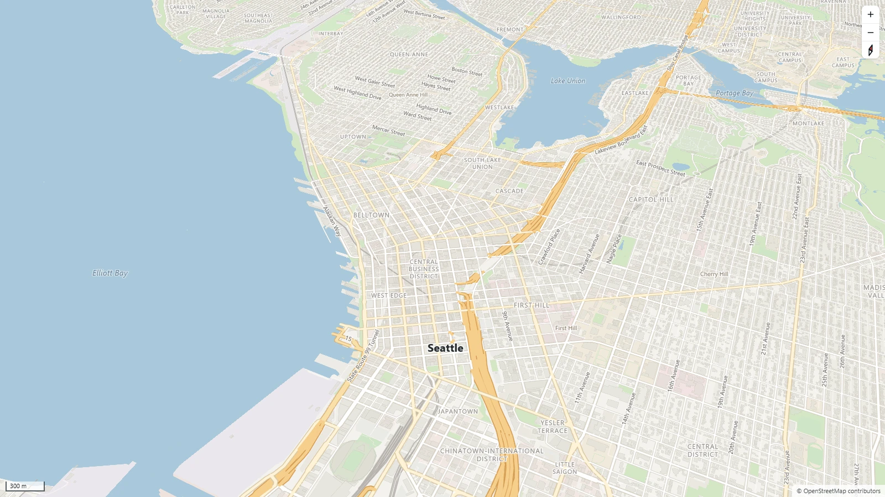

<p align="center">
  <picture>
    <source media="(prefers-color-scheme: dark)" srcset="assets/maplet-logo-white.svg">
    
  </picture>
</p>

Maplet GL JS is a map library for the web. It draws vector tiles, raster tiles and GeoJSON with WebGL2, and it doesn't depend on any other package. You can try it on the [website](https://grangedevgroup-code.github.io/maplet-gl-js/).



<sub>Map data © OpenStreetMap contributors</sub>

## Install

```sh
npm install github:grangedevgroup-code/maplet-gl-js
```

The built files end up in `node_modules/maplet-gl/dist`. If you don't use a bundler, copy `dist/maplet.js` next to your page and import it from there.

## A first map

This one shows two places and needs no tile server or API key.

```html
<div id="map" style="position: absolute; inset: 0"></div>
<script type="module">
  import * as maplet from "maplet-gl";

  const places = {
    type: "FeatureCollection",
    features: [
      { type: "Feature", properties: { name: "Pike Place Market" }, geometry: { type: "Point", coordinates: [-122.3422, 47.6097] } },
      { type: "Feature", properties: { name: "Space Needle" }, geometry: { type: "Point", coordinates: [-122.3493, 47.6205] } },
    ],
  };

  const map = new maplet.Map({
    container: "map",
    center: [-122.335, 47.608],
    zoom: 13,
    style: {
      version: 1,
      sources: { places: { type: "geojson", data: places } },
      layers: [
        { id: "background", type: "background", paint: { color: "#eef1ef" } },
        { id: "dots", type: "circle", source: "places", paint: { radius: 7, color: "#246a50" } },
        {
          id: "names",
          type: "symbol",
          source: "places",
          layout: { text: ["get", "name"], anchor: "top", offset: [0, 0.8] },
          paint: { color: "#10191d", haloColor: "#ffffff", haloWidth: 1.5 },
        },
      ],
    },
  });

  map.addControl(new maplet.NavigationControl());
</script>
```

Open the page through a local web server. Browsers won't load modules from a `file://` address.

## A real basemap

Maplet can make its own street map tiles from OpenStreetMap data, so you don't need a map provider. Download an extract for your region from [Geofabrik](https://download.geofabrik.de/), then cut out the area you want:

```sh
npx maplet-tiles --input washington-latest.osm.pbf --bbox=-122.45,47.48,-122.22,47.74 --output seattle.pmtiles
```

Put `seattle.pmtiles` on any web server that handles range requests, and point the built-in style at it:

```js
import * as maplet from "maplet-gl";

const map = new maplet.Map({
  container: "map",
  style: maplet.lightStyle({ url: "seattle.pmtiles" }),
  center: [-122.335, 47.608],
  zoom: 12,
});
```

The OpenStreetMap license asks you to credit the data. The style shows "© OpenStreetMap contributors" in the corner, so leave that visible.

## What else it does

You can replace GeoJSON with `setData()` while the map is running, move the camera with `easeTo` and `flyTo`, tilt and rotate the map, and style features from their own data with expressions like `match` and `interpolate`. Buildings can rise into 3D, and labels follow streets and keep out of each other's way.

While you pan and zoom, Maplet fills gaps with tiles it already has from other zoom levels, so the map doesn't flash empty. Tiles are decoded in Web Workers, and the whole library is about 77 KB gzipped.

3D buildings and terrain aren't finished yet, and the API may still change before 1.0.

## Docs

- [Styles](docs/style.md): sources, layers, properties and expressions
- [API](docs/api.md): map options, methods and events
- [Tiles](docs/tiles.md): building tiles and what's in them

## Working on Maplet

You'll need Node.js 22.18 or newer.

```sh
npm install
npm run dev
```

`npm run dev` serves the examples at http://127.0.0.1:8080/examples/ and rebuilds whenever you change something in `src`. Before sending a change, run `npm run verify` for lint, types and unit tests, and `npm run test:browser`, which draws test maps in Chrome and checks the pixels.

## License

MIT
